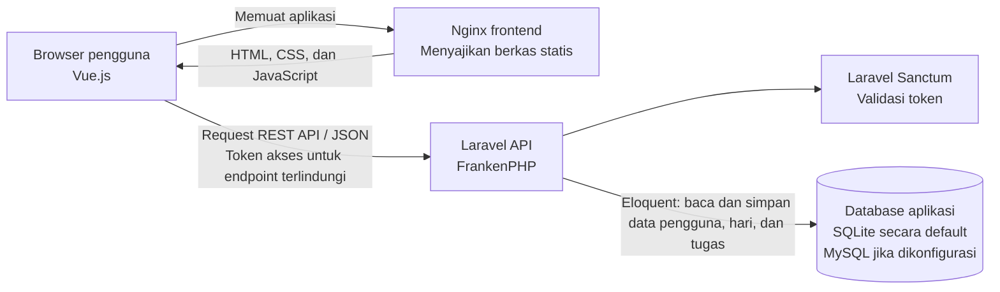

# 1.3 Arsitektur Sistem

Sistem aplikasi manajemen tugas ini menggunakan arsitektur client-server yang
memisahkan frontend dan backend. Vue.js berjalan di browser pengguna, sedangkan
Nginx menyajikan berkas statis hasil build frontend. Request API dikirim langsung
dari browser ke backend Laravel yang berjalan menggunakan FrankenPHP.

Alur penggunaan dimulai ketika browser meminta aplikasi frontend kepada Nginx.
Nginx mengirimkan berkas HTML, CSS, dan JavaScript Vue.js; Nginx pada konfigurasi
ini hanya menyajikan frontend dan tidak meneruskan request API. Selanjutnya,
frontend mengirim request REST API dalam format JSON langsung ke backend. Alamat
API ditentukan oleh `VITE_API_URL` dan secara default mengarah ke
`http://localhost:8000/api`.

Laravel menyediakan endpoint registrasi dan login, serta endpoint terproteksi
untuk data pengguna, hari, dan tugas. Setelah login, frontend menyertakan token
akses Sanctum pada header otorisasi HTTP. Middleware `auth:sanctum` memvalidasi
token sebelum request yang memerlukan autentikasi diproses. Laravel memvalidasi
input dan menggunakan Eloquent untuk membaca atau menyimpan data. Data tugas dan
hari dihubungkan dengan pengguna yang sedang login.

Koneksi database ditentukan oleh konfigurasi Laravel melalui `DB_CONNECTION`.
Berkas `.env.example` menetapkan SQLite sebagai default. Konfigurasi MySQL dan
driver `pdo_mysql` tersedia untuk penggunaan MySQL apabila variabel lingkungan
database diatur sesuai kebutuhan. Dockerfile frontend membangun aplikasi Vue lalu
menjalankannya dengan Nginx, sedangkan Dockerfile backend menjalankan Laravel
menggunakan FrankenPHP dan menjalankan migrasi saat container mulai. Repository
ini tidak menyertakan konfigurasi Docker Compose, sehingga topologi jaringan dan
nilai konfigurasi deployment aktual perlu disesuaikan dengan lingkungan
pengerjaan.
