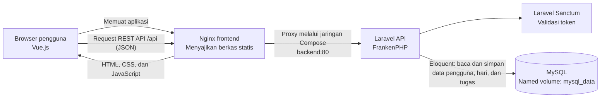

# 1.3 Arsitektur Sistem

Sistem aplikasi manajemen tugas ini menggunakan arsitektur client-server
berbasis Docker Compose. Vue.js berjalan di browser pengguna, Nginx menyajikan
berkas statis frontend sekaligus meneruskan request API ke Laravel/FrankenPHP,
dan Laravel membaca atau menyimpan data pada MySQL.

Docker Compose menjalankan tiga service: `frontend`, `backend`, dan `mysql`.
Browser meminta aplikasi Vue.js pada port frontend. Nginx mengirimkan berkas
statis dan meneruskan request `/api` ke service `backend` melalui jaringan
internal Docker Compose. Browser menggunakan URL API relatif `/api`, sehingga
tidak perlu mengetahui alamat IP container maupun alamat IP laptop. Backend
juga dipublikasikan pada port host `8000` untuk kebutuhan pengujian langsung,
misalnya menggunakan Postman pada port host `8001`.

Laravel menyediakan endpoint registrasi dan login, serta endpoint terproteksi
untuk data pengguna, hari, dan tugas. Setelah login, frontend menyertakan token
akses Sanctum pada header otorisasi HTTP. Middleware `auth:sanctum` memvalidasi
token sebelum request yang memerlukan autentikasi diproses. Laravel memvalidasi
input dan menggunakan Eloquent untuk membaca atau menyimpan data. Data tugas dan
hari dihubungkan dengan pengguna yang sedang login.

Koneksi database Compose memakai MySQL dengan kredensial yang dibaca dari berkas
`.env` lokal di root repository. Backend menunggu health check MySQL berhasil,
kemudian menjalankan migrasi saat container mulai. Data database disimpan pada
named volume `mysql_data`, sehingga tetap ada setelah `docker compose down`;
volume tersebut dihapus jika `docker compose down -v` dijalankan. Dockerfile
frontend membangun aplikasi Vue dengan Node.js lalu menyajikan hasil build
menggunakan Nginx. Dockerfile backend menjalankan Laravel menggunakan
FrankenPHP. Konfigurasi layanan dan jaringan berada pada `compose.yaml`.

Untuk menjalankan sistem dari PowerShell di root repository:

1. Salin `.env.example` menjadi `.env` dengan `Copy-Item .env.example .env`.
2. Dari folder `backend`, jalankan `php artisan key:generate --show`, lalu salin
   hasilnya ke nilai `APP_KEY` di berkas `.env` root. Ganti juga password contoh
   database dengan nilai lokal yang tidak digunakan di tempat lain.
3. Jalankan `docker compose config --quiet` untuk memeriksa konfigurasi, lalu
   `docker compose up -d --build` untuk membangun dan menjalankan semua service.
4. Periksa status dengan `docker compose ps`, lalu buka
   `http://localhost:8080` di browser. API dapat diuji melalui website pada
   origin yang sama atau langsung ke `http://localhost:8001/api` dari Postman.
5. Untuk memastikan data bertahan, jalankan `docker compose down` lalu
   `docker compose up -d`. Jangan menambahkan opsi `-v` jika volume database
   harus tetap dipertahankan.
